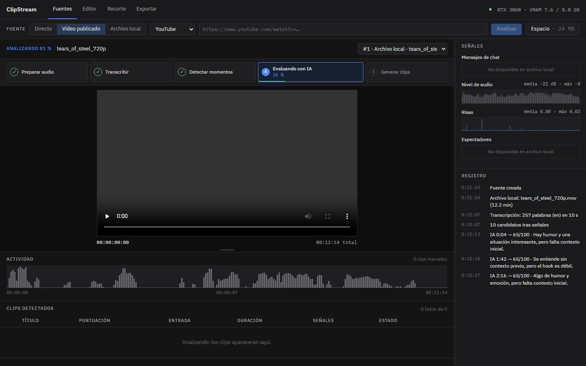
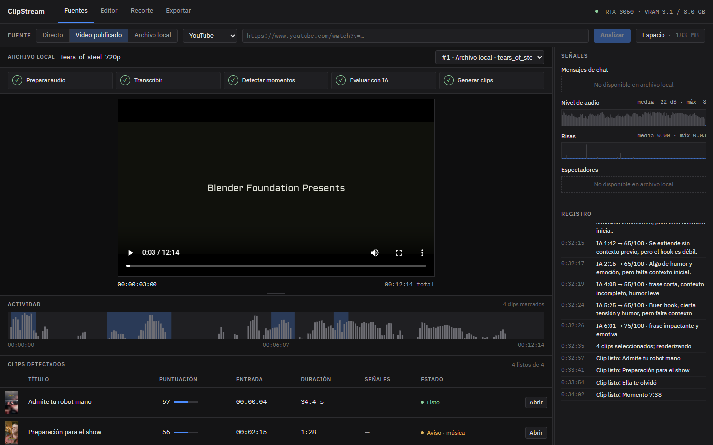
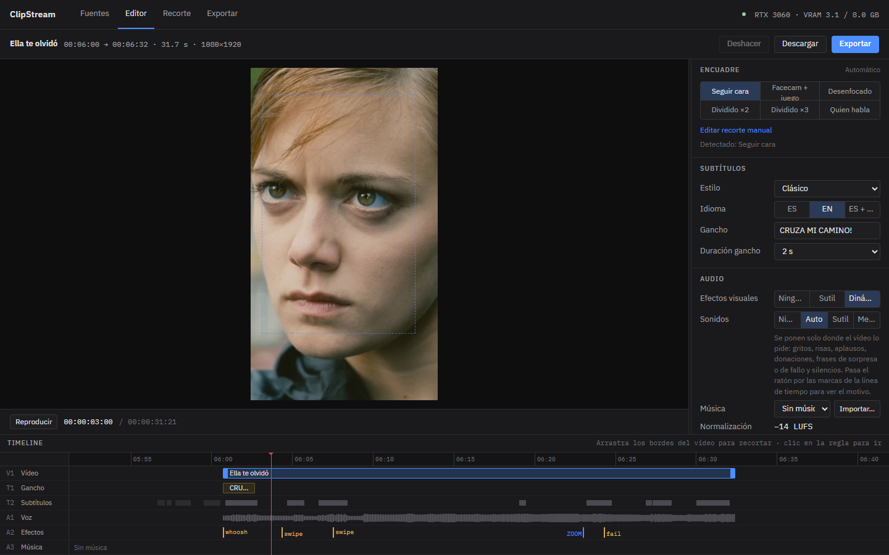
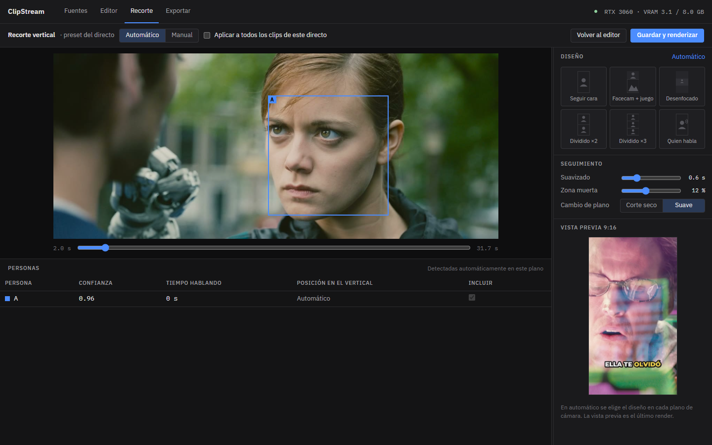
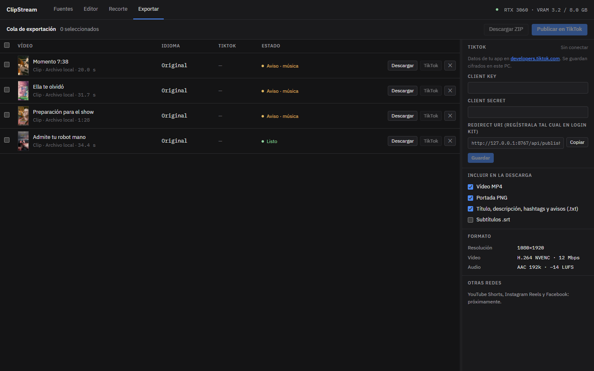

# ClipStream

**Clips verticales automáticos para TikTok, Reels y Shorts, en tu propio PC.**

ClipStream analiza un directo, un vídeo publicado o un archivo de tu ordenador, encuentra los mejores momentos y los
convierte en clips 9:16 con subtítulos palabra a palabra, encuadre automático sobre las caras, efectos y título. Todo
se procesa **en local** con tu tarjeta gráfica NVIDIA y con **Ollama** como IA: sin suscripciones ni subir tus vídeos a
ningún servidor.



> ⚠️ **Uso bajo tu responsabilidad.** ClipStream se distribuye con licencia MIT, *tal cual* y sin garantías.
> Tú eres responsable de lo que procesas y publicas: usa solo vídeos tuyos o para los que tengas permiso y respeta
> los derechos de autor y las normas de cada plataforma. La app avisa (música detectada, permiso del streamer), pero
> no sustituye tu criterio.

---

## Índice

- [Qué hace](#qué-hace)
- [Capturas](#capturas)
- [Requisitos](#requisitos)
- [Instalación](#instalación)
- [Primer arranque](#primer-arranque)
- [Cómo se usa](#cómo-se-usa)
- [Publicar en TikTok (opcional)](#publicar-en-tiktok-opcional)
- [Dónde guarda las cosas](#dónde-guarda-las-cosas)
- [Cómo funciona por dentro](#cómo-funciona-por-dentro)
- [Compilar desde el código](#compilar-desde-el-código)
- [Solución de problemas](#solución-de-problemas)
- [Licencia y créditos](#licencia-y-créditos)

---

## Qué hace

- **Fuentes:** directos de **YouTube** y **Kick** (captura mientras se emiten), vídeos publicados de YouTube y Kick
  (si fue un directo, también lee la repetición del chat de YouTube) y **archivos de tu PC** (MP4, MOV, MKV…).
- **Detección de momentos:** transcripción con Whisper, picos de audio, risas, aplausos y gritos (YAMNet), actividad
  del chat y una **IA local** (Qwen 2.5 7B vía Ollama) que puntúa cada candidato y explica por qué.
- **Clips de 3 s a 3 min** cortados en frases completas, sin repetirse.
- **Encuadre vertical automático:** sigue la cara de quien habla, pantalla dividida para 2 o 3 personas, *facecam +
  juego*, o fondo desenfocado. Se puede ajustar a mano.
- **Subtítulos** palabra a palabra (español, inglés o ambos) con texto gancho al inicio.
- **Efectos según el contenido:** zoom en el momento cumbre, temblor en gritos, destellos en aplausos, pulsos en risas,
  y **sonidos solo cuando el vídeo los pide** (aplausos, donaciones, frases de sorpresa o de fallo…).
- **Audio** normalizado a −14 LUFS, música de fondo opcional (solo con licencia libre) con *ducking* bajo la voz.
- **Título, descripción y hashtags** en español e inglés, y portada.
- **Salida:** MP4 1080×1920 H.264 (NVENC) listo para subir, más portada PNG, texto y subtítulos .srt.
- **Publicar en TikTok** desde la app con la API oficial (requiere tu propia app de desarrollador, ver más abajo).

## Capturas

| | |
|---|---|
|  |  |
| **Fuentes:** clips detectados, señales y registro de la IA | **Editor:** encuadre, subtítulos, efectos y línea de tiempo |
|  |  |
| **Recorte:** personas detectadas y diseño del vertical | **Exportar:** guardar en carpeta y publicar en TikTok |

<sub>Capturas hechas procesando la película *Tears of Steel* (CC-BY 3.0, © Blender Foundation · mango.blender.org).</sub>

## Requisitos

| | Mínimo | Probado |
|---|---|---|
| Sistema | Windows 10 u 11, 64 bits | Windows 11 Pro |
| Tarjeta gráfica | NVIDIA con **6–8 GB de VRAM** y drivers recientes (CUDA 12) | RTX 3060 8 GB |
| Memoria RAM | 16 GB | |
| Disco | ~15 GB libres (programa, modelos de IA y tus clips) | |
| Internet | Para el primer arranque (descarga de modelos) y para descargar vídeos de YouTube/Kick | |
| IA local | [Ollama](https://ollama.com/download/windows) con el modelo `qwen2.5:7b-instruct` (~4,7 GB) | |

Sin tarjeta NVIDIA no funciona la transcripción ni el render acelerado.

## Instalación

1. Descarga **`ClipStream-Setup-x.y.z.exe`** desde la página de
   [**Releases**](../../releases/latest) de este repositorio.
2. Ejecútalo. Se instala solo para tu usuario y **no pide permisos de administrador**.
   - El instalador no está firmado digitalmente, así que Windows SmartScreen puede avisar: pulsa
     **Más información → Ejecutar de todos modos**.
3. Instala **Ollama** desde <https://ollama.com/download/windows> y descarga el modelo. En una terminal:
   ```bash
   ollama pull qwen2.5:7b-instruct
   ```
   (También puedes hacerlo desde ClipStream, en el panel **Preparar ClipStream**.) Ollama tiene que estar abierto
   mientras usas ClipStream: se queda en la bandeja del sistema.

Para desinstalar: *Configuración de Windows → Aplicaciones → ClipStream → Desinstalar*. Tus clips y modelos se quedan
en `%LOCALAPPDATA%\ClipStream` por si reinstalas; borra esa carpeta si quieres liberar el espacio.

## Primer arranque

La primera vez, ClipStream muestra **Preparar ClipStream** y descarga lo que necesita (con barra de progreso):

| Componente | Tamaño | Para qué |
|---|---|---|
| Runtime de NVIDIA CUDA (cuBLAS, cuDNN) | ~1,3 GB | Transcripción en la GPU |
| ffmpeg con NVENC | ~100 MB | Cortar y renderizar vídeo (si ya tienes ffmpeg en el PATH, lo usa) |
| Whisper large-v3-turbo | ~1,6 GB | Transcripción con tiempos por palabra |
| MediaPipe (caras, pose, audio) | ~20 MB | Encuadre y detección de risas y aplausos |
| Modelo de IA de Ollama | ~4,7 GB | Puntuar momentos y escribir títulos |

Todo se guarda en `%LOCALAPPDATA%\ClipStream` y no se vuelve a descargar.

## Cómo se usa

### 1. Fuentes
Elige **Directo**, **Vídeo publicado** o **Archivo local**, pega el enlace o abre el archivo y pulsa **Analizar**
(o **Iniciar captura** en un directo). Verás el proceso por pasos, cada uno con su porcentaje:

> Descargar → Preparar audio → Transcribir → Detectar momentos → Evaluar con IA → Generar clips

Los clips se generan **de uno en uno**, en el orden del vídeo, y van apareciendo en la tabla con su progreso.

**En directos**, ClipStream trabaja unos minutos por detrás de la emisión: recorta al momento los **picos fuertes**
(gritos, subidas de audio, avalanchas en el chat) y, además, analiza el directo **por bloques** y saca el mejor
momento de cada uno, aunque sea un directo tranquilo de conversación. Junto a «Iniciar captura» eliges el ritmo:
un clip cada **3, 5 o 10 minutos**, o **solo momentos fuertes**. En el registro verás el resultado de cada bloque.
Cuando el directo termina, se reprocesa entero en cuanto YouTube publica la repetición.

- **Empezar limpio:** al analizar un vídeo nuevo, ClipStream te pregunta si quieres borrar los anteriores con sus
  clips (o conservarlos, o recordar tu elección).
- **Espacio:** el botón de la barra muestra cuánto ocupa cada vídeo y permite borrar los que ya no necesitas. Tus
  archivos originales del PC y los clips que ya guardaste en una carpeta no se tocan nunca.
- El panel derecho y el monitor se pueden **ampliar arrastrando** sus bordes (doble clic para restablecer).

### 2. Editor
Abre un clip para ajustar los bordes en la línea de tiempo, el **encuadre**, el **estilo e idioma de los subtítulos**,
el **texto gancho**, los **efectos visuales** (Ninguno / Sutil / Dinámico), los **sonidos** (Ninguno / Auto / Sutil /
Meme), la **música**, el título, la descripción, los hashtags y la portada. Pulsa **Renderizar cambios** para
aplicarlos. **Descargar** guarda el MP4 en la carpeta que elijas; **Exportar** te lleva a la pantalla Exportar.

### 3. Recorte
Encuadre vertical a mano: cajas por persona sobre el vídeo original, diseño (seguir cara, dividido, facecam…),
suavizado del seguimiento y vista previa 9:16. Se puede guardar como ajuste para todos los clips del mismo directo.

### 4. Exportar
Marca los clips y pulsa **Guardar en carpeta** (eliges la carpeta con el diálogo de Windows) o **Descargar** en cada
fila. Puedes incluir portada, texto (título, descripción, hashtags y avisos) y subtítulos .srt. **✕** quita un clip
de la lista sin borrar nada (con *Deshacer* y *Ver quitados*).

## Publicar en TikTok (opcional)

ClipStream puede publicar y **programar** clips en tu cuenta con la **Content Posting API** oficial de TikTok. Para
eso necesitas registrar **tu propia app** en <https://developers.tiktok.com> y pegar su *Client Key* y *Client
Secret* en *Exportar → TikTok* (se guardan cifrados con la protección de datos de Windows).

- Redirect URI que hay que registrar en Login Kit (Desktop): `http://127.0.0.1:8765/api/publish/tiktok/callback/`
- Permisos: `user.info.basic` y `video.publish` (Direct Post).
- **Mientras TikTok no audite tu app, todo lo que publiques sale privado («Solo yo»)** y tu cuenta debe ser privada.
- TikTok limita a unas 15 publicaciones al día por cuenta; ClipStream lo respeta.
- Normas importantes de TikTok: no aprueban apps de uso personal ni las que copian contenido de otras plataformas.

Guía paso a paso y valores para el formulario: [docs/tiktok/GUIA_REVISION.md](docs/tiktok/GUIA_REVISION.md) ·
[docs/tiktok/FORMULARIO.md](docs/tiktok/FORMULARIO.md).

## Dónde guarda las cosas

```
%LOCALAPPDATA%\ClipStream\
├── storage\        base de datos, vídeos analizados y sus clips (sources\<id>\clips\...)
├── models\         Whisper, MediaPipe...
├── runtime\        CUDA y ffmpeg descargados
├── assets\         fuentes, música y efectos con licencia libre
└── logs\           clipstream.log (aquí se ve cualquier error)
```

Ajustes avanzados (opcional): crea `%LOCALAPPDATA%\ClipStream\.env` con, por ejemplo:

```ini
CLIPSTREAM_PORT=8765
CLIPSTREAM_LAN_ACCESS=false              # true: abrir la interfaz desde el móvil en la misma WiFi
CLIPSTREAM_LLM_MODEL=qwen2.5:7b-instruct # otro modelo de Ollama, si lo prefieres
CLIPSTREAM_OLLAMA_URL=http://127.0.0.1:11434
CLIPSTREAM_WHISPER_MODEL=large-v3-turbo
```

## Cómo funciona por dentro

```
Fuente (directo / vídeo / archivo)
  → descarga (yt-dlp, streamlink) y audio (ffmpeg)
  → transcripción por palabra (faster-whisper large-v3-turbo, GPU)
  → señales: audio, risas/aplausos/gritos (YAMNet), chat, espectadores
  → candidatos (puntuación de señales) → ajuste a frases → sin duplicados
  → juez IA local (Qwen 2.5 7B vía Ollama) + títulos y hashtags ES/EN
  → encuadre vertical (MediaPipe: caras, pose, quién habla)
  → render uno a uno (ffmpeg + NVENC): subtítulos ASS, efectos, sonidos, −14 LUFS
  → MP4 1080×1920 + portada + texto + .srt
```

- **Motor:** Python 3.11 · FastAPI · WebSocket para el progreso en directo · SQLite · cola Huey.
- **Interfaz:** React + Vite + TypeScript, dentro de una ventana propia (pywebview / WebView2).
- **GPU:** un gestor reparte los 8 GB de VRAM: Whisper y el modelo de IA se cargan por turnos (pico ≈ 6,3 GB).
- **Instalador:** PyInstaller (carpeta) + Inno Setup; los modelos pesados se descargan en el primer arranque.

## Compilar desde el código

Requisitos: **Python 3.11**, **Node 22**, **Git**, **ffmpeg** con NVENC y libass
(`winget install Gyan.FFmpeg`), **Ollama** y, para el instalador, **Inno Setup 6**.

```bash
git clone <url-de-este-repositorio> clipstream
cd clipstream
py -3.11 -m venv .venv
.venv\Scripts\python -m pip install -e ".[dev]"
cd frontend && npm ci && npm run build && cd ..
```

- **Ventana de escritorio:** `run_clipstream.bat`
- **Desarrollo** (motor en `http://127.0.0.1:8765` + Vite con recarga en caliente en `http://localhost:5173`):
  `run_dev.bat`
- **Tests:** `.venv\Scripts\python -m pytest -q`
- **Instalador** (tests → interfaz → PyInstaller → autodiagnóstico → Inno Setup): `installer\build.bat`.
  El resultado queda en `build\installer\ClipStream-Setup-<versión>.exe`.

Estructura principal:

```
app/          motor: api/ (rutas), clipper/ (análisis y render), shared/ (Whisper, ffmpeg, efectos,
              subtítulos, música...), publish/ (TikTok), core/ (BD, GPU, cola, descargas)
frontend/     interfaz React (pages/: Fuentes, Editor, Recorte, Exportar)
config/       ajustes y rutas
assets/       fuentes OFL, música y efectos CC0, registro de licencias
installer/    PyInstaller, Inno Setup y avisos de terceros
docs/         capturas, guía de TikTok y páginas legales
tests/        tests automáticos
```

Las **microseries** (historias de dominio público con IA, Fase 3 del proyecto) están en `app/stories` pero
**desactivadas**. Se reactivan con `CLIPSTREAM_STORIES_ENABLED=true` e instalando el extra `.[stories]` (PyTorch,
diffusers, Kokoro; ojo: la voz usa phonemizer/espeak-ng, que son GPL-3.0).

## Solución de problemas

| Problema | Qué hacer |
|---|---|
| No arranca o se cierra | Mira `%LOCALAPPDATA%\ClipStream\logs\clipstream.log`. `ClipStream.exe --selftest` hace un autodiagnóstico. |
| «Ollama no está en marcha» / sin títulos | Abre Ollama y comprueba `ollama list` (debe salir `qwen2.5:7b-instruct`). |
| Windows SmartScreen bloquea el instalador | *Más información → Ejecutar de todos modos* (el instalador no está firmado). |
| «GPU no detectada» | Instala o actualiza los drivers de NVIDIA. |
| Falta memoria de vídeo | Cierra juegos u otras apps que usen la GPU; ClipStream carga los modelos por turnos. |
| Un vídeo de YouTube no descarga | Algunos vídeos tienen restricciones (edad, región, privados). Prueba a descargarlo y usar *Archivo local*. |
| NVENC falla | ClipStream cambia solo a codificación por CPU (libx264), más lenta. |
| El disco se llena | Botón **Espacio** en Fuentes, o activa «Empezar limpio». |

## Licencia y créditos

- Código de ClipStream: **[MIT](LICENSE)** · © 2026 ClipStream contributors. **Uso bajo tu propia responsabilidad.**
- Componentes de terceros y sus licencias: [installer/THIRD_PARTY.md](installer/THIRD_PARTY.md). El ejecutable
  publicado no incluye componentes GPL; ffmpeg (GPL) se descarga aparte y se ejecuta como programa independiente.
- Modelos: Whisper (MIT), Qwen 2.5 (Apache-2.0, vía Ollama), MediaPipe / YAMNet (Apache-2.0).
- Fuentes Montserrat (SIL OFL). Música de fondo y efectos de sonido generados por código (CC0).
- Capturas: *Tears of Steel* (CC-BY 3.0) © Blender Foundation · mango.blender.org.
- TikTok, YouTube y Kick son marcas de sus respectivos dueños. ClipStream no está afiliado ni respaldado por ellos.
